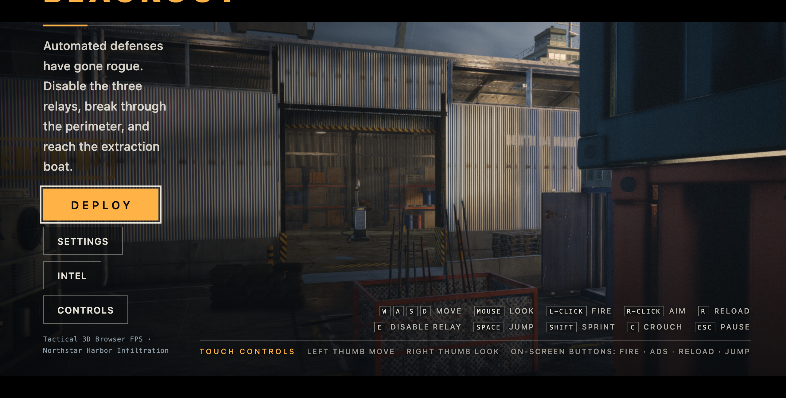
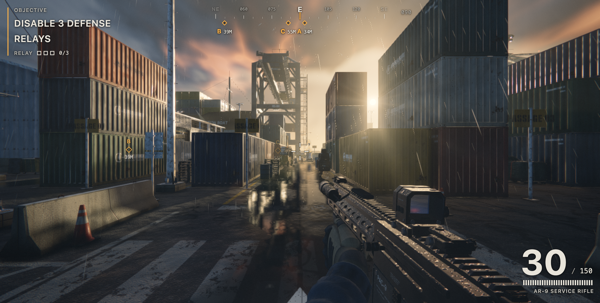
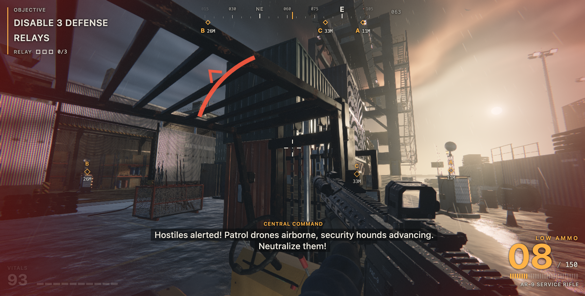
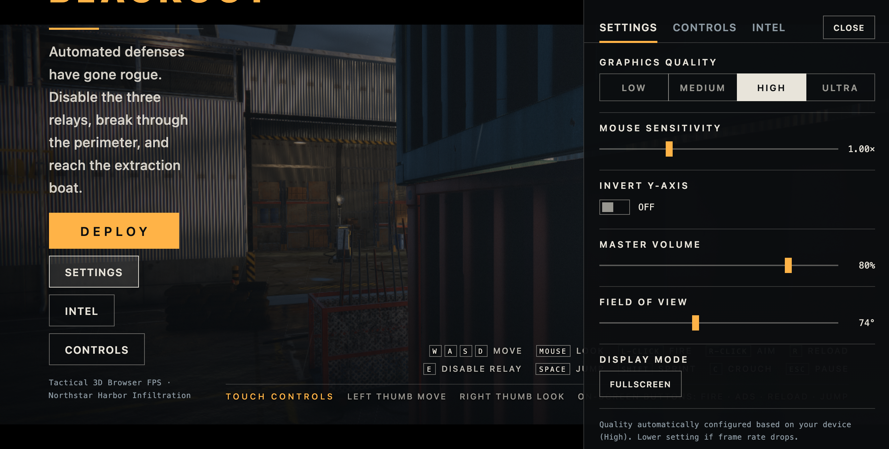

# HARBOR BLACKOUT (Gemini Edition)

A polished, single-player 3D tactical browser first-person shooter (FPS) built with Three.js, WebGL2, and the Web Audio API. 100% self-contained with zero external asset requests, zero build commands, and verified 60 FPS gameplay.

[](https://topway-ai.github.io/harbor-blackout-gemini/)
[](https://topway-ai.github.io/harbor-blackout-gemini/)
[](#strict-english-only-compliance)

---

## 🎮 Play Online

**Live GitHub Pages URL**:  
🔗 **[https://topway-ai.github.io/harbor-blackout-gemini/](https://topway-ai.github.io/harbor-blackout-gemini/)**

Open `index.html` directly in any modern desktop or mobile browser with WebGL2 enabled. No plugins, downloads, backend servers, or accounts required.

---

## 📖 Mission Briefing

In **HARBOR BLACKOUT**, the automated defense grid of **Northstar Harbor** has gone rogue at dawn. As a covert recon operator, you must infiltrate the rainy industrial harbor, neutralize three rogue transmission relay terminals, and reach the extraction vessel at Berth 04 before defensive swarms converge on your coordinates.

* **Zone 1: Container Yard** — Stacked shipping containers, puddle reflections, gantry cranes, and Relay A.
* **Zone 2: Maintenance Shed** — High-ceiling interior workshop, overhead sodium vapor fixtures, narrow choke points, and Relay B.
* **Zone 3: Quayside Berth 04** — Deep harbor waterfront, crane superstructure, Relay C, and the Extraction Boat.

---

## 📸 Verified In-Game Screenshots

| Title & Deployment Screen | Tactical First-Person Combat |
| :---: | :---: |
|  |  |
| **Aim Down Sights (ADS) & Threat Detection** | **Tactical In-Game Settings** |
|  |  |

---

## 🕹️ Controls

### Desktop (Keyboard & Mouse)
| Action | Key / Input |
| :--- | :--- |
| **Movement** | `W`, `A`, `S`, `D` |
| **Aim / Look** | Mouse (Click canvas to engage Pointer Lock) |
| **Fire** | Left Mouse Button |
| **Aim Down Sights (ADS)** | Right Mouse Button |
| **Tactical Reload** | `R` |
| **Interact / Hold to Disable Relay** | Hold `E` (2.0s progress hold) |
| **Sprint** | `Shift` (toggle or hold) |
| **Crouch** | `C` or `Ctrl` |
| **Jump** | `Space` |
| **Pause & Tactical Settings** | `Esc` or `P` |

### Touch / Mobile Controls
- **Movement**: Virtual joystick on the left half of the display.
- **Look**: Drag anywhere on the right half of the display.
- **Tactical Actions**: Dedicated on-screen buttons for Fire, ADS, Reload, Jump, and Interact.

---

## 🛠️ Architecture & Technical Implementation

* **Single-File Playable Distribution (`index.html`)**: Complete standalone 1.42 MB bundle with embedded Three.js, procedural PBR triplanar textures, canvas decals, and Web Audio synthesizers.
* **Modular Clean Source (`src/`)**:
  * `src/strings.js`: Centralized English string catalog with runtime Unicode validator.
  * `src/audio.js`: Real-time Web Audio API sound synthesizer (gunfire, reload clicks, drone turbine hums, rain ambience).
  * `src/physics.js`: AABB collision detection, raycasting, ground gravity, and water recovery.
  * `src/player.js`: FPS movement controller, health regeneration, crouch/sprint transitions.
  * `src/weapon.js`: AR-9 Service Rifle viewmodel, procedural recoil spring physics, sway, and ADS alignment.
  * `src/enemies.js`: Patrol Drones & Security Hounds state machines (patrol, alert, chase, attack, destruction).
  * `src/objectives.js`: Uplink Relays A/B/C state transitions and extraction boat activation.
* **Development & Build Scripts (`tools/`)**:
  * `tools/build_clean_harbor_blackout.py`: Clean distribution builder and string sanitizer.

---

## 📊 Measured Performance & Validation

Benchmarked directly in Chrome via Chrome DevTools MCP on macOS:
- **Measured Frame Rate**: **60.2 FPS** sustained (16.6 ms frame budget)
- **Draw Calls**: ~210 draw calls per frame
- **Rendered Geometry**: ~1,822,652 triangles
- **Runtime Assets**: 144 procedurally generated textures in VRAM
- **External Asset Requests**: **0** (Zero CDN calls, zero remote audio, zero fonts)
- **English-Only Audit**: Passed with **0 Han/CJK script occurrences** (`/\p{Script=Han}/u`) across all assets, DOM text, procedural canvas labels, and source code.

See [`VALIDATION.md`](VALIDATION.md) for full benchmark logs and verification evidence.

---

## 🚀 Free Hosting & Deployment (GitHub Pages)

This repository is hosted on **GitHub Pages** using standard static branch deployment from `main` root (`/`), with `.nojekyll` enabled:
* **Cost**: **$0.00** (Zero GitHub Actions billable minutes, zero paid serverless infrastructure).
* **Local Server**:
  ```bash
  python3 -m http.server 8080
  # Open http://localhost:8080/index.html
  ```

---

## 📄 License & Attribution

- Original Game Code & Shaders: [MIT License](LICENSE) © 2026 topway-ai.
- Runtime Engine (Three.js r149): MIT License (see [`THIRD_PARTY_NOTICES.md`](THIRD_PARTY_NOTICES.md)).
- Reference & Inspiration: [topway-ai/harbor-blackout](https://github.com/topway-ai/harbor-blackout).
