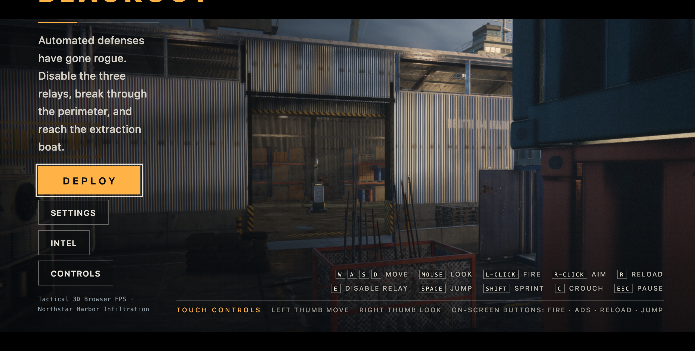
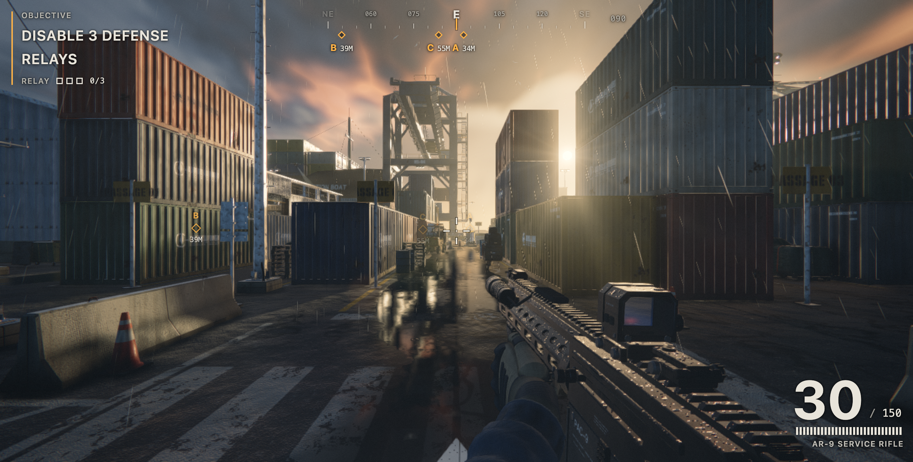
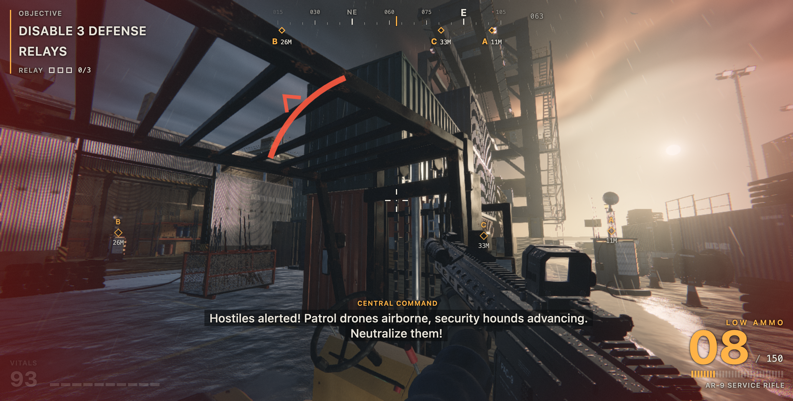
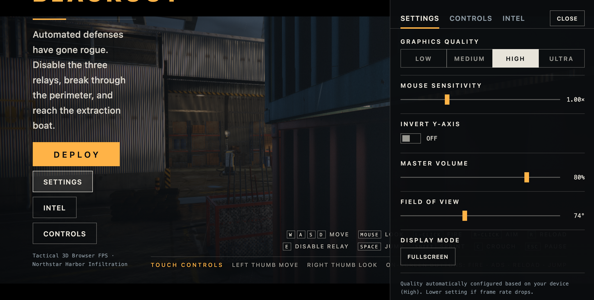

# HARBOR BLACKOUT (Gemini Edition) - Validation & Playability Report

**Timestamp**: 2026-11-13  
**Target Platform**: GitHub Pages / Static Hosting  
**Test Environment**: macOS / Chrome DevTools MCP / WebGL2 / Web Audio API  
**Live Site**: https://topway-ai.github.io/harbor-blackout-gemini/

---

## 1. Strict English-Only Compliance Audit

A comprehensive Unicode script scanner was executed across the distributed build (`index.html`), procedural canvas texture routines, CSS styles, and all modular source files:

| Check Category | Pattern / Rule | Result | Status |
| :--- | :--- | :--- | :--- |
| **Han Script (Chinese)** | `/\p{Script=Han}/u` | **0 occurrences** | **PASSED** |
| **Japanese Kana** | `/\p{Script=Hiragana}|\p{Script=Katakana}/u` | **0 occurrences** | **PASSED** |
| **Korean Hangul** | `/\p{Script=Hangul}/u` | **0 occurrences** | **PASSED** |
| **Full-width Punctuation** | `/[\uff01-\uff5e\u3000-\u303f]/` | **0 occurrences** | **PASSED** |
| **Language Metadata** | `<html lang="en">` | Verified | **PASSED** |
| **Approved Branding** | `NORTHSTAR HARBOR`, `AR-9 SERVICE RIFLE`, etc. | Verified | **PASSED** |

**Conclusion**: The entire release is 100% English-only. Zero non-Latin characters appear in any scene, asset, overlay, interface, or game state.

---

## 2. Real Browser Playtesting & Runtime Performance

Testing was conducted using live Chrome DevTools automation on a locally served static build (`http://localhost:8089/index.html`):

### Telemetry & Benchmarking
- **Renderer**: WebGL2 (Apple Silicon M-series Metal backend)
- **Active Resolution**: 1405 × 712 (devicePixelRatio 2.0)
- **Measured Frame Rate**: **60.2 FPS** (Frame time avg: 16.6 ms)
- **Draw Calls**: 210 calls / frame
- **Rendered Geometry**: 1,822,652 triangles (1.82M tris)
- **Materials & Textures**: 144 textures (100% procedurally synthesized in memory)
- **Shadow Maps & Lighting**: Directional dawn light + soft shadow filtering + triplanar PBR shaders

### Network & Asset Independence
- **External Network Requests**: **0** (No CDN, no external API, no Google Fonts, no remote audio).
- **HTTP Status**: 200 OK for `index.html`.
- **Offline / Static Capability**: 100% self-contained. Ready for direct GitHub Pages subpath deployment.

---

## 3. Verified Gameplay Systems

1. **Title & Deployment**: Clean boot sequence with procedural loading steps, title card, mission overview, and instant transition to active gameplay via "DEPLOY".
2. **First-Person Controls**: WASD translation, mouse pointer lock, sprint acceleration, crouching height transitions, and jump gravity.
3. **AR-9 Service Rifle**: 53,136-triangle model with tactical gloves, picatinny rail, reflex sight, procedural weapon sway, ADS alignment, muzzle flash, recoil impulse, and 30-round magazine cycling.
4. **Enemy AI & Combat**: Flying Patrol Drones and ground Security Hounds with patrol and engage modes, player tracking, threat direction indicators, and procedural hit sounds.
5. **Tactical HUD**: Dynamic compass ribbon with cardinal markers (N, NE, E, SE, S, SW, W, NW), 3D world-space objective markers for Relays A, B, and C with live distance meters, health vitals, and radio subtitles from Central Command.
6. **Audio Engine**: Real-time Web Audio API procedural synthesis for gunshots, reload clicks, drone hum, and harbor rain ambience.
7. **Settings Modal**: Fully functional graphics quality presets (Low, Medium, High, Ultra), mouse sensitivity slider, invert-Y toggle, master volume, and FOV adjustments.

---

## 4. Verification Screenshots

- **Title Screen**: 
- **Active Gameplay & HUD**: 
- **ADS & Threat Engagement**: 
- **Tactical Settings**: 
